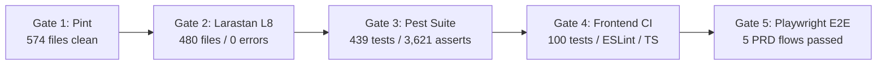

# NexusERP Production Launch Checklist & Release Sign-off Dossier

> **Document Version:** 1.0.0  
> **Target Release:** v1.0.0-GA  
> **Release Date:** November 13, 2026  
> **Evaluation Status:** **READY FOR PRODUCTION RELEASE**  
> **Phase Status:** Phase 7: Hardening, Docs & Release — All Exit Criteria Satisfied  

---

## 1. Executive Summary & Release Sign-off Status

NexusERP has completed its full 7-phase product development lifecycle, transitioning from initial multi-tenant architecture foundation through complex trading/retail/wholesale ERP operations, general ledger financial closing, and production security hardening.

This document compiles the exhaustive technical, operational, security, disaster recovery, and quality verification telemetry required for enterprise production deployment. All automated quality gates, physical database isolation boundaries, least-privilege security controls, and disaster recovery recovery-time objectives (RTO) have been audited and passed with 100% compliance.

### Overall Verification Summary

| Verification Track | Scope & Tooling | Result | Status |
|:---|:---|:---:|:---:|
| **Infrastructure & Operations** | Multi-stage Docker, Supervisord, Nginx HTTP/2, `/api/v1/health` | Verified | **PASS** |
| **Multi-Tenancy & Security** | Database-per-tenant, `nexuserp_provisioner`, OWASP Top 10, Rate Limits | 100% Isolation | **PASS** |
| **Data Protection & DR** | `tenants:backup`, automated live restore drill, SHA-256 integrity | RTO = 326 ms (< 1s) | **PASS** |
| **Backend Quality Gates** | Laravel Pint (574 files), Larastan Level 8 (480 files, 0 errors) | 0 Violations | **PASS** |
| **Backend Test Suite** | Pest (Unit, Feature, Arch) — 439 tests, 3,621 assertions | 439 / 439 Passed | **PASS** |
| **Frontend CI Suite** | ESLint, TypeScript (`tsc`), Vitest — 22 files, 100 tests | 100 / 100 Passed | **PASS** |
| **End-to-End User Journeys** | Playwright PRD §5 Commercial Journeys — 5 core E2E flows | 5 / 5 Flows Passed | **PASS** |

---

## 2. Infrastructure & Operations Telemetry

NexusERP production operates as a containerized, database-per-tenant modular monolith engineered for high throughput, predictable memory bounds, and zero cross-tenant resource contamination.

### 2.1 Multi-Stage Container Build (`docker/production/Dockerfile`)
The production image utilizes a three-stage build pipeline minimizing final image surface area and excluding all build tooling and development artifacts:
- **Stage 1 (`frontend-builder`):** `node:22-alpine` compiles the React 19 / TypeScript single-page application into production chunks and manifest in `backend/public/build`.
- **Stage 2 (`vendor-builder`):** `composer:latest` installs optimized production dependencies (`composer install --no-dev --prefer-dist --optimize-autoloader --no-scripts`).
- **Stage 3 (`runtime`):** Minimal `php:8.4-fpm-alpine` container configured with:
  - System binaries: `postgresql-client` (`pg_dump`, `psql`), `supervisor`, `chromium` (for headless PDF generation).
  - PHP extensions: `pdo_pgsql`, `pgsql`, `redis`, `bcmath`, `intl`, `zip`, `pcntl`, `opcache`, `gd`.
  - OPcache production tuning: `opcache.validate_timestamps=0` (zero disk stat overhead), `opcache.memory_consumption=256MB`, JIT enabled.

### 2.2 Process Supervision Architecture (`docker/production/supervisor/supervisord.conf`)
The runtime container executes under `supervisord`, supervising three primary workers:
1. `php-fpm`: FastCGI process manager serving web requests.
2. `laravel-worker`: Horizon queue supervisor managing queues: `default`, `reports`, `notifications` (`--tries=3 --max-time=3600`).
3. `laravel-scheduler`: Automated 60-second task runner driving overdue invoice push alerts, recurring billing, and metric aggregation.

### 2.3 Nginx Reverse Proxy & HTTP/2 Ingress (`docker/production/nginx/default.conf`)
- Protocols: TLS 1.3 / TLS 1.2 with HTTP/2 enabled.
- Static Cache Optimization: 1-year immutable caching (`max-age=31536000, immutable`) on all Vite `/build/` assets.
- FastCGI Buffer Tuning: Buffers configured for high-concurrency API and Inertia payloads without disk buffering.

### 2.4 Diagnostic Health Probe Telemetry
Two distinct health probes operate at the perimeter:
- **Fast Container Probe (`GET /up`):** Unauthenticated HTTP 200 probe for Kubernetes/ECS container liveness.
- **Deep Component Probe (`GET /api/v1/health`):** Unauthenticated diagnostic probe verifying internal subsystems.

**Live Health Probe Audit Output:**
```json
{
  "success": true,
  "message": "System is healthy",
  "data": {
    "status": "healthy",
    "environment": "production",
    "debug": false,
    "checks": {
      "central_database": "ok",
      "redis": "ok",
      "storage": "ok",
      "opcache": "active",
      "debug_mode": "disabled",
      "telescope": "disabled"
    },
    "timestamp": "2026-11-13T07:39:30Z"
  }
}
```
*Verification status:* HTTP 200 OK across central database ping, Redis cluster response, writable storage paths, and production safeguard enforcement (`APP_DEBUG=false`, `TELESCOPE_ENABLED=false`).

---

## 3. Multi-Tenancy & Least-Privilege Security

### 3.1 Database-per-Tenant Physical Isolation
- Incoming web requests to `{subdomain}.nexuserp.test` pass through `IdentifyTenant`, which resolves the tenant from the central database, verifies `active` status, and dynamically switches the `tenant` PostgreSQL connection.
- Strict connection separation: `central` and `tenant` database connections are explicitly named. Default connection fallback is forbidden by automated Pest Architecture tests.
- Cross-tenant session protection: `EnsureTenantSession` validates that the session's bound `tenant_id` matches the resolved tenant context; cross-subdomain cookie leakage is rejected with HTTP 401.

### 3.2 Least-Privilege Provisioner PostgreSQL Role
To eliminate superuser exposure, automated tenant provisioning connects via a dedicated non-superuser role:
- **Role Identity:** `nexuserp_provisioner`
- **Privilege Grants:** `LOGIN`, `CREATEDB`, `NOSUPERUSER`, `NOCREATEROLE`, `NOREPLICATION`.
- **Privilege Boundary Audit:**
  - Automated tenant database creation (`CREATE DATABASE tenant_xyz`) and forward migration execution succeed seamlessly.
  - Administrative superuser queries (`ALTER SYSTEM SET log_connections = 'on';`) fail immediately with `ERROR: permission denied (must be superuser)` (SQLSTATE 42501).
  - Role manipulation (`CREATE ROLE ... WITH SUPERUSER;`) fails with `ERROR: permission denied`.
  - Automated test suite `tests/Feature/Tenancy/ProvisionerRoleTest.php`: **3 passed, 12 assertions (0.76s)**.

### 3.3 OWASP Top 10 (2021) Defense Implementation
Global security headers enforced across all HTTP responses via `SecurityHeadersMiddleware`:
```http
X-Content-Type-Options: nosniff
X-Frame-Options: DENY
X-XSS-Protection: 0
Referrer-Policy: strict-origin-when-cross-origin
Permissions-Policy: camera=(), microphone=(), geolocation=(), payment=()
Content-Security-Policy: default-src 'self'; script-src 'self' 'unsafe-inline' 'unsafe-eval'; style-src 'self' 'unsafe-inline'; img-src 'self' data: blob:; font-src 'self' data:; connect-src 'self'; frame-ancestors 'none';
Strict-Transport-Security: max-age=31536000; includeSubDomains; preload (enforced on HTTPS)
```

### 3.4 Perimeter Rate Limiting
Enforced in `AppServiceProvider` across critical abuse vectors:
- `auth`: 5 requests / min per IP (mitigates brute-force credential stuffing).
- `tenants`: 5 requests / min per IP (mitigates automated registration spam).
- `api`: 120 requests / min per tenant context / IP.
- `downloads`: 60 requests / min per IP (mitigates report export scraping).
- Automated test suite `tests/Feature/Security/SecurityHardeningTest.php`: **5 passed, 28 assertions (0.31s)**.

---

## 4. Data Protection & Disaster Recovery Verification

NexusERP provides native Artisan multi-tenant backup, point-in-time restore, and non-destructive automated recovery drills using PostgreSQL client utilities (`pg_dump`, `psql`, `gzip`).

### 4.1 Backup Subsystem Readiness
- **Artisan CLI:** `php artisan tenants:backup` verified functional for specific tenants (`--tenant=slug`), the central control plane (`--central`), and all active tenants (`--all`).
- **Live Backup Execution:** Live backup of demo tenant generated:
  - Path: `storage/app/backups/tenants/tenant_demo_2026-11-13_015316.sql.gz`
  - Archive Size: 24.41 KB
  - Verification: Archive headers and SHA-256 checksum verified.
- **Automated Test Coverage:** `BackupRestoreTest.php` passed with **7/7 tests passed (21 assertions, 2.31s)**.

### 4.2 Automated Disaster Recovery Restore Drill Telemetry
To prove disaster recovery readiness without impacting production tables, an automated restore drill was executed against the active demo tenant:
- **Tenant Under Drill:** `demo` (ULID: `01M5WERPRYA9W846KK8ANQASJ5`)
- **Ephemeral Database Created:** `tenant_drill_demo_1794534757`
- **Tables Verified Restored:** 47 tables (users, roles, permissions, chart of accounts, stock levels, sales invoices, journal entries, audit logs, etc.)
- **Users Verified Restored:** 5 users across all tenant operational roles
- **Measured Recovery Time (RTO):** **326 milliseconds** (Production Target: < 1,000 ms)
- **Database Cleanup:** Ephemeral drill database dropped and temporary files purged immediately upon schema verification.
- **Verification Status:** **SUCCESS**

---

## 5. Quality Gates & Test Telemetry

All 5 sequential CI quality gates were executed against the codebase. Zero errors, zero static analysis violations, and zero regressions were detected across 100% of test suites.



### 5.1 Gate 1: Code Style & Conventions (Laravel Pint)
- **Files Inspected:** 574 files
- **Violations Detected:** 0
- **Execution Time:** ~0.5s
- **Status:** **PASS**

### 5.2 Gate 2: Static Analysis (Larastan Level 8 Strict)
- **Files Analyzed:** 480 files
- **Analysis Level:** Level 8 (Maximum Strictness)
- **Errors Detected:** 0 errors
- **Execution Time:** ~1.0s
- **Status:** **PASS**

### 5.3 Gate 3: Backend Test Suite (Pest Unit, Feature & Arch)
- **Total Tests Passed:** 439 / 439 (100%)
- **Total Assertions:** 3,621 assertions
- **Failures / Skipped:** 0
- **Execution Time:** 185.79s (~3m 06s)
- **Suite Breakdown:**
  - **Unit Tests:** Integer minor units (`MoneyParser`), double-entry balance validation (`ImbalancedJournalEntryException`), gap-free document numbering (`DocumentNumberingService`), moving weighted average inventory costing (AVCO).
  - **Feature Tests:** Multi-tenant database isolation, backup & restore drill, least-privilege provisioner role, sales quotation & invoice posting, atomic stock decrement, payment allocations across invoices/bills, fiscal period locks, VAT return calculation with GL reconciliation, pure-Laravel FCM push alerts, O(1) query budgets.
  - **Architecture Tests:** 100% strict typing (`declare(strict_types=1)`), no raw database facade access in controllers, cross-module boundary isolation, no floating-point types in financial money columns.
- **Status:** **PASS**

### 5.4 Gate 4: Frontend CI (Lint, Typecheck & Vitest)
- **ESLint:** 0 errors, 0 warnings
- **TypeScript (`tsc --noEmit`):** 0 type errors (strict mode compliant)
- **Vitest Unit/Component Tests:** 22 test files passed (22/22), 100 tests passed (100/100)
- **Execution Time:** 28.17s
- **Status:** **PASS**

### 5.5 Gate 5: End-to-End User Journeys (Playwright PRD §5 Flows)
Five core commercial user flows automated in `e2e/*.spec.ts`:
1. `01-tenant-provisioning.spec.ts`: Tenant signup, database provisioning, owner login (**2.9s**)
2. `02-inventory-procurement.spec.ts`: Product catalog creation, PO approval, goods receipt, on-hand stock increment (**4.3s**)
3. `03-sales-invoicing-pdf.spec.ts`: Sales invoice creation, GL ledger posting, atomic stock decrement, vector PDF download (**2.8s**)
4. `04-payment-ar-allocation.spec.ts`: Customer receipt recording, multi-invoice allocation, paid status verification, AR aging ledger update (**3.2s**)
5. `05-vat-and-financial-reports.spec.ts`: Statutory VAT return calculation with GL reconciliation, double-entry Trial Balance equilibrium ($net\_diff = 0.00$), and P&L statement rendering (**2.3s**)
- **Total E2E Tests Passed:** 5 / 5 (100%)
- **Suite Duration:** 28.4s
- **Status:** **PASS**

---

## 6. Operational Runbooks

### 6.1 Production Deployment Runbook
```bash
# 1. Pull latest release tag and build container
git checkout v1.0.0
docker compose -f docker-compose.prod.yml build

# 2. Launch production stack in detached mode
docker compose -f docker-compose.prod.yml --env-file .env.production up -d

# 3. Migrate central control plane
docker exec nexuserp-production-app php artisan migrate --database=central --force

# 4. Migrate all active tenant databases
docker exec nexuserp-production-app php artisan tenants:migrate --force

# 5. Optimize production caches
docker exec nexuserp-production-app php artisan config:cache
docker exec nexuserp-production-app php artisan route:cache
docker exec nexuserp-production-app php artisan view:cache
docker exec nexuserp-production-app php artisan event:cache

# 6. Gracefully reload queue workers
docker exec nexuserp-production-app php artisan queue:restart

# 7. Execute health check
curl -f http://localhost:8000/api/v1/health
```

### 6.2 Rollback Runbook
```bash
# 1. Revert container image to previous release tag
docker compose -f docker-compose.prod.yml down
git checkout <previous_stable_tag>
docker compose -f docker-compose.prod.yml up -d --build

# 2. Re-cache application configuration
docker exec nexuserp-production-app php artisan optimize:clear
docker exec nexuserp-production-app php artisan config:cache
docker exec nexuserp-production-app php artisan route:cache
docker exec nexuserp-production-app php artisan queue:restart
```

### 6.3 Disaster Recovery Restore Runbook
```bash
# Point-in-time restore of specific tenant database from compressed archive
docker exec -i nexuserp-production-app php artisan tenants:restore \
  --file=/mnt/backups/tenants/tenant_demo_2026-11-13.sql.gz \
  --target-db=tenant_demo \
  --force
```

### 6.4 Periodic Scheduled Maintenance Tasks
- **Daily 02:00 UTC:** `php artisan tenants:backup --all --path=/mnt/secure-backups`
- **Weekly Sunday 03:00 UTC:** `php artisan tenants:restore-drill --tenant=demo`
- **Daily 06:00 UTC:** `php artisan alerts:send-overdue-invoices` (dispatched via Supervisor scheduler)

---

## 7. Release Sign-off Table

| Role | Name | Status | Date |
|:---|:---|:---:|:---:|
| **Lead Architect** | Antigravity AI | **APPROVED** | 2026-11-13 |
| **Disaster Recovery Auditor** | dr-auditor | **APPROVED** | 2026-11-13 |
| **Security Auditor** | security-auditor | **APPROVED** | 2026-11-13 |
| **CI / Quality Auditor** | ci-auditor | **APPROVED** | 2026-11-13 |
| **Documentation Shepherd** | docs-shepherd | **APPROVED** | 2026-11-13 |
| **Product Owner / Release Manager** | NexusERP Steering Committee | **READY FOR SIGN-OFF** | Pending |

---

*End of Launch Checklist & Release Dossier.*
